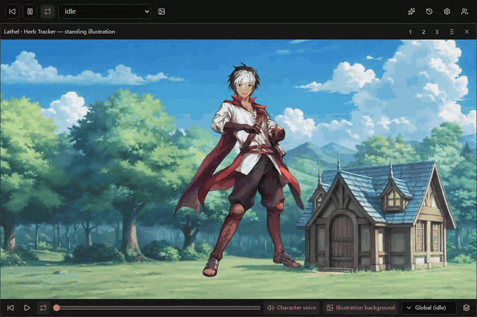

# BD2ModPreview

**简体中文** | [English](README.en.md)

用于预览**《棕色尘埃 2》Mod** 的轻量级 Spine 动画查看器，可由 [BD2ModManager](https://github.com/bruhnn/BD2ModManager) 启动。

本分支新增立绘服装背景、人物点击动作与角色语音，以及与技能过场动画同步的音效和台词。

## 立绘：静态展示与背景

打开已识别的角色立绘后，会自动显示对应服装的背景。暂停动画即可静态查看，也可以平移、缩放画面，并通过**立绘背景**按钮切换当前预览的背景显示。

背景映射覆盖 **207 套服装**。原版资源和使用已识别骨骼文件名的 Mod 共用同一映射；手动选择的背景会保留。



## 立绘：点击互动与语音

点击人物的可见区域，会播放一次互动动作，并从该服装的**三条官方普通台词**中随机选择一条播放。动作结束后，人物返回待机状态。

- 连续点击会中止上一句语音，并避免紧接着重复同一句。
- 拖拽用于平移画面，点击背景不会触发人物互动。
- 在**设置 → 立绘点击互动**中，可以调整互动开关、语音语言和音量。
- 预览控制栏的**角色语音**按钮可快速静音。
- 支持日语和韩语。当前服装缺少所选语言时，会使用另一种可用语言，并提示实际播放的语言。


## 技能过场：动画、音效与台词

支持的技能资源打开后，默认进入**游戏过场动画（预览）**，按照完整的游戏时间轴同步播放动画、技能音效和角色台词。

暂停、继续、重播、拖动进度和循环播放都会同步处理声音。切换资源或关闭预览时，会停止当前声音。如果在时间轴加载期间手动选择了其他动画或自定义序列，会保留手动选择。

技能台词与立绘共用语音语言和语音音量设置。在**设置 → 技能演出音频**中，可以分别开关技能台词、技能音效，并单独调整音效音量。预览会显示实际加载的语言、备用语言和缺失音频提示。


**GIF 演示没有声音。** 应用会从配置好的本地音频素材库中播放语音和音效。

## 本地素材库

在**设置**中选择 Brown-Dust-2-Asset 素材库的根目录。使用已识别骨骼文件名的角色 Mod，可以复用素材库中的原版服装背景和语音。

相关目录结构如下：

```text
Brown-Dust-2-Asset/
├─ spine/
│  ├─ char/
│  └─ cutscenes/
├─ ui/
│  └─ novel_background/
├─ backgrounds/
│  └─ cutscene/
└─ audio/
   ├─ char/
   │  ├─ index.json
   │  ├─ ja-JP/
   │  └─ ko-KR/
   └─ cutscene/
      ├─ index.json
      ├─ timelines/
      ├─ sfx/
      ├─ ja-JP/
      └─ ko-KR/
```

**提取后的音频文件和运行索引需要单独准备**，它们不包含在本仓库或 EXE 中。选择素材库根目录不会复制素材。

当前已验证的本地提取数据包括：

| 内容 | 覆盖范围 |
| --- | --- |
| 立绘服装背景 | 207 套服装映射 |
| 立绘普通台词 | 日语 621 条；韩语 549 条 |
| 技能过场时间轴 | 174 个过场；538 个音频片段 |
| 技能音频文件 | 音效 174 个；日语台词 360 条；韩语台词 310 条 |

实际覆盖范围取决于游戏安装目录中的可用文件。在当前快照中，50 条缺失的韩语技能台词可以使用日语备用音频，另有 1 条台词在已安装的两种语言中均缺失。缺少音频不会阻止动画播放。

素材格式、映射关系、提取来源和播放行为详见：

- [立绘与背景映射](docs/illustration-backgrounds.md)
- [立绘点击互动与语音](docs/standing-interactions.md)
- [技能过场音频](docs/skill-cutscene-audio.md)

## 使用方法

通常由 BD2ModManager 启动预览，也可以手动打开 Mod 文件夹：

```powershell
BD2ModPreview.exe "D:\Mods\My Costume"
```

文件夹中需要包含 `.skel` 或 `.json` 骨骼文件、对应的 `.atlas` 文件，以及所需的 PNG 纹理。

### 手动选择动画与自定义序列

在动画列表中选择单个动画，或创建自定义播放序列。关闭**循环动画**后可单次播放。

使用自定义音频时，选择包含已提取的 `.ogg`、`.mp3` 或 `.wav` 文件的文件夹。自动匹配会使用 Spine 事件中的音频路径或动画名称；**完整序列音频**可为整个自定义序列指定一个音频文件。

## 开发

```sh
pnpm install
pnpm dev
pnpm build
node --test tests/*.test.mjs
```

构建 Windows 应用可使用现有的 Tauri 构建流程：

```sh
pnpm tauri build
```

## Spine 运行时许可

本项目使用 [Esoteric Software](http://esotericsoftware.com/) 提供的官方 Spine 运行时。

Spine 运行时遵循其独立的许可条款。**使用或分发基于这些运行时构建的项目，需要持有有效的 Spine 许可证。**

[Spine 运行时许可](http://esotericsoftware.com/spine-runtimes-license)

> 本预览工具用于学习与调试，与 Esoteric Software 无关联，也未获得其背书。

## 相关项目

- [BD2ModManager](https://github.com/bruhnn/BD2ModManager) — 内置 BD2ModPreview 支持的 Mod 管理器。

## 许可证

项目代码遵循 [MIT 许可证](LICENSE)。Spine 运行时和游戏媒体资源保留各自的许可条款。
