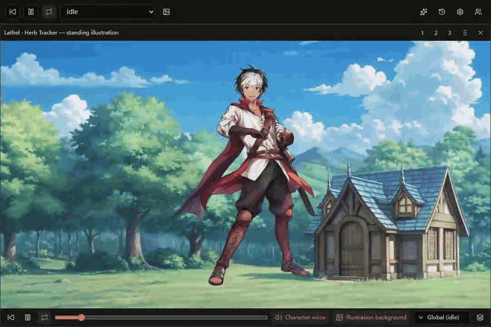
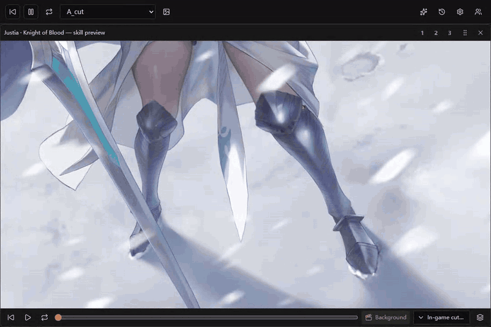

# BD2ModPreview

A lightweight Spine animation previewer for **Brown Dust 2** mods, used by [BD2ModManager](https://github.com/bruhnn/BD2ModManager).

This fork adds costume backgrounds for standing illustrations, click interactions with character voices, and synchronized sound effects and dialogue for game skill cutscenes.

## Standing illustrations: display and backgrounds

Open a recognized standing illustration to show the character with its matching costume background. Pause the animation for a still view, pan or zoom to inspect it, and use **Illustration background** to toggle the background for that preview.

The mapping covers **207 costumes**. Original assets and Mods with recognized skeleton filenames use the same mapping. Backgrounds selected manually are preserved.


## Standing illustrations: click interactions and voices

Click the visible character to play its interaction motion once and randomly choose one of its **three official normal voice lines**. The character returns to idle when the motion finishes.

- Repeated clicks replace the previous voice and avoid immediately repeating the same line.
- Dragging pans the view; clicking the background does not trigger the character.
- **Settings → Standing illustration interactions** controls interactions, voice language, and volume.
- The preview's **Character voice** button provides quick mute.
- Choose Japanese or Korean. If the selected language is unavailable for that costume, the preview uses the other available language and reports the actual language.



## Skill cutscenes: animation, effects, and dialogue

Supported skill assets open directly in **In-game cutscene (Experimental)**. The complete game timeline plays the animation, sound effects, and character dialogue together.

Pause, resume, restart, seek, and loop keep the audio aligned with the animation. Switching assets or closing a preview stops its sounds. A manual animation or sequence selected while the timeline loads is preserved.

Skill dialogue shares the standing voice language and voice volume settings. **Settings → Skill cutscene audio** provides separate voice and sound effect switches, plus sound effect volume. The preview reports the loaded language, fallback voices, and missing audio.



**The GIFs are silent.** The application plays voices and effects from the configured local audio library.

## Local asset library

In **Settings**, select the root of your Brown-Dust-2-Asset folder. Recognized character Mods can reuse the original costume backgrounds and audio from that library.

The relevant layout is:

```text
Brown-Dust-2-Asset/
├─ spine/
│  ├─ char/
│  └─ cutscenes/
├─ ui/
│  └─ novel_background/
├─ backgrounds/
│  └─ cutscene/
└─ audio/
   ├─ standing/
   │  ├─ index.json
   │  ├─ ja-JP/
   │  └─ ko-KR/
   └─ skills/
      ├─ index.json
      ├─ timelines/
      ├─ sfx/
      ├─ ja-JP/
      └─ ko-KR/
```

**Extracted audio files and their runtime catalogs must be supplied separately.** They are not bundled in this repository or the EXE. Choosing a library root does not copy the assets.

The verified local extraction currently contains:

| Content | Coverage |
| --- | --- |
| Standing costume backgrounds | 207 costume mappings |
| Standing normal voices | 621 Japanese lines; 549 Korean lines |
| Skill cutscene timelines | 174 cutscenes; 538 audio clips |
| Skill audio files | 174 effects; 360 Japanese voices; 310 Korean voices |

Coverage depends on the files available in your game installation. In this snapshot, 50 missing Korean skill lines can use Japanese fallback; one skill line is absent from both installed languages. Missing audio does not block the animation.

See the detailed documentation for asset formats, mappings, extraction provenance, and playback behavior:

- [Illustration backgrounds](docs/illustration-backgrounds.md)
- [Standing interactions and voices](docs/standing-interactions.md)
- [Skill cutscene audio](docs/skill-cutscene-audio.md)

## Usage

BD2ModManager normally launches the previewer. You can also open a Mod folder manually:

```powershell
BD2ModPreview.exe "D:\Mods\My Costume"
```

The folder must contain a `.skel` or `.json` skeleton, its `.atlas`, and the corresponding PNG textures.

### Manual animations and custom sequences

Use the animation list to choose an individual animation or create a custom sequence. Turn off **Loop Animation** to play once.

For custom audio, choose a folder containing extracted `.ogg`, `.mp3`, or `.wav` clips. Automatic matching uses Spine event audio paths or animation names. **Full-sequence audio** assigns one clip to the complete custom sequence.

## Development

```sh
pnpm install
pnpm dev
pnpm build
node --test tests/*.test.mjs
```

To build the Windows application, use the existing Tauri build workflow:

```sh
pnpm tauri build
```

## Spine Runtime License

This project uses the official Spine runtimes provided by [Esoteric Software](http://esotericsoftware.com/).

These runtimes have their own license terms. **You must have a valid Spine license** to use or distribute projects built with them.

[Spine Runtimes License](http://esotericsoftware.com/spine-runtimes-license)

> This previewer is for educational and debugging purposes. It is not affiliated with or endorsed by Esoteric Software.

## Related project

- [BD2ModManager](https://github.com/bruhnn/BD2ModManager) — Mod manager with built-in support for BD2ModPreview.

## License

Project code is licensed under the [MIT License](LICENSE). Spine runtimes and game media retain their respective licenses.
